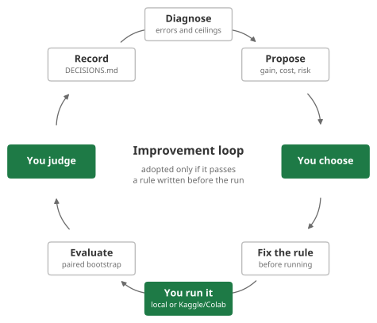

# evidence-driven-ml

A [Claude Code](https://claude.com/claude-code) skill for running a machine-learning or deep-learning project together with
Claude, one reviewed step at a time and with decisions backed by measurements.

It was distilled from a real project (segmentation and counting of fluorescent cell nuclei) and captures the way of
working that made it reliable:

- **Understand before planning.** In-depth reading of the dataset documentation, the annotation protocol and the
  literature, then an EDA aimed at extracting every insight that changes a decision. Metrics, splits, preprocessing,
  loss and baselines are chosen from what these phases found.
- **One step at a time.** Claude proposes and explains each step; the user chooses whether to write the code with
  guidance or to delegate it; nothing moves on without review.
- **Rules before results.** Every change is compared with the adopted pipeline on the same data, with paired-bootstrap
  intervals, against a rule written before the run. The test set is evaluated once.
- **An error-driven improvement loop.** Diagnose the errors, compute the ceiling of each fix, propose candidates with
  their cost, let the user choose, run (locally or on Kaggle/Colab), verify, evaluate, let the user judge, record.
- **Readable project documents.** `PLAN.md`, `DECISIONS.md`, `HYPERPARAMETERS.md`, `PROPOSALS.md` and `GUIDE.md`
  instead of one ever-growing plan.
- **Clean delivery.** Simple, analytical final notebooks, a clear README, and minimal, consistent presentation slides.

## How it works

<p align="center"></p>

<p align="center"></p>

The green steps are the user's: Claude proposes, implements and measures; the user chooses, runs the GPU jobs and judges.

## Install

Copy the folder into your personal skills directory:

```bash
git clone <this repository> ~/.claude/skills/evidence-driven-ml
```

Claude Code loads it automatically in every project. It activates when you start or plan an ML project, explore a
dataset, analyse a model's errors, decide whether to adopt a change, or prepare notebooks and slides; you can also ask
for it by name.

## Contents

```
SKILL.md                         the method in short: roles, lifecycle, improvement loop, rules
references/
  planning.md                    kickoff interview, framing, metrics, decision rule, baselines, steps
  understanding-and-eda.md       documentation and literature, EDA for maximum insight, insights → decisions
  improvement-loop.md            the loop in eight steps, with examples
  decision-rules.md              roles of the data, paired bootstrap, gates, cross-validation, the test set
  engineering.md                 repositories, code organisation, regression checks, Kaggle/Colab runs
  project-docs.md                the five project documents
  presentation.md                final notebooks and README
  slides.md                      the slide style
assets/templates/                PLAN.md, DECISIONS.md, HYPERPARAMETERS.md, PROPOSALS.md, GUIDE.md
scripts/paired_bootstrap.py      paired-bootstrap interval of a metric difference (self-test with no arguments)
evals/                           three test cases in the `claude plugin eval` format
docs/                            the README diagrams and the script that draws them (matplotlib)
```

## Tests

`evals/` holds three test cases (starting a project, analysing errors, evaluating a variant). The input files of the
second and third case are synthetic and are regenerated with `python evals/make_inputs.py .` from the skill folder. With
Claude Code they run with `claude plugin eval . --allow-tools Write,Edit,Bash --scaffold`, with and without the skill.
These are real, billed model runs.

## Requirements

Python 3 with NumPy for `scripts/paired_bootstrap.py`. Nothing else is installed by the skill.

## License

MIT — see `LICENSE`.
